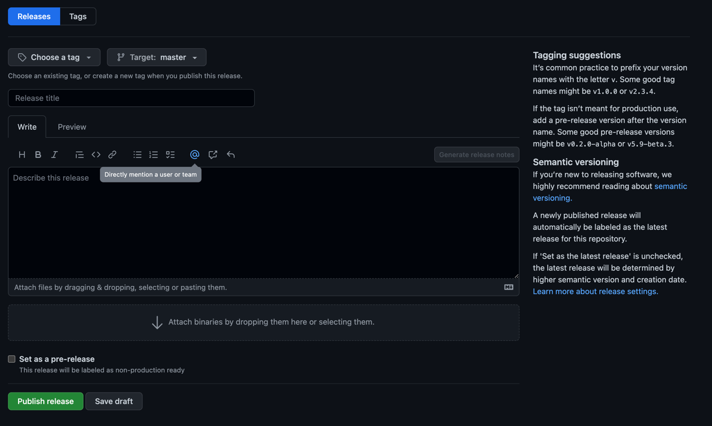

# Contributing to Wirespec

Check out ways to contribute to Wirespec:

## Feature requests

When you have an idea on how we could improve, please check
our [discussions](https://github.com/flock-community/wirespec/discussions) to see if there are similar ideas or feature
requests. If there are none, please [start](https://github.com/flock-community/wirespec/discussions/new) your feature
request as a new discussion topic. Add the title `[Feature Request] My awesome feature` and a description of what you
expect from the improvement and what the use case is.

## We ♥ pull requests

Help out the whole community by sending your merge requests and issues. Check out how to set it up:

Prerequisites: the JDK and Node.js versions pinned in [`.sdkmanrc`](.sdkmanrc) and [`.nvmrc`](.nvmrc), and Docker.

Setup:

``` bash
# Clone the repo:
git clone https://github.com/flock-community/wirespec.git
cd wirespec

# Create a branch for your changes
git checkout -b feature/my-awesome-feature
```

Make sure everything works as expected:

``` bash
make
```

This builds and tests the project, and compiles the definitions in `types` with every CLI artifact. The result is in
`types/out`.

Create a Pull Request:

- At [GitHub Flock](https://github.com/flock-community/wirespec) click on fork (at the right top)

``` bash
# add fork to your remotes
git remote add fork git@github.com:<your-user>/wirespec.git

# push new branch to your fork
git push -u fork feature/my-awesome-feature
```

- Go to your fork and create a Pull Request :).

Some things that will increase the chance that your merge request is accepted:

- Write in a functional style (we use [Arrow](https://arrow-kt.io/))
- Write test scripts.
- Write a [good commit message](https://www.conventionalcommits.org/).

## Emitter test fixtures

Each emitter keeps its expected output as `.txt` files under `src/compiler/emitters/<lang>/fixtures/`, and its tests
compare the generated code against them. When you change the output of an emitter on purpose, regenerate the fixtures
of that module, substituting `kotlin` with the language you changed:

``` bash
./gradlew :src:compiler:emitters:kotlin:updateEmitterFixtures
```

The task overwrites the `.txt` files, so always review the diff before committing.

## Releases

A release is made in the GitHub UI, at [new release](https://github.com/flock-community/wirespec/releases/new):



- Create a tag according to the pattern `v*.*.*`
- Enter the release title `Release *.*.*`
- Click `Publish release`

## Claude Code cloud sessions

A cloud session starts with an empty `~/.gradle` and downloads every dependency from Maven Central, which often
answers with `429 Too Many Requests`. The [Gradle dependency cache](.github/workflows/gradle-dep-cache.yml) workflow
publishes a Gradle [read-only dependency cache](https://docs.gradle.org/current/userguide/dependency_caching.html#sec:shared-readonly-cache)
monthly as an asset of the [`gradle-dep-cache`](https://github.com/flock-community/wirespec/releases/tag/gradle-dep-cache)
release. To use it, in Claude Code (desktop or web) edit the settings of your cloud environment:

- Environment variable: `GRADLE_RO_DEP_CACHE=/opt/gradle-ro-dep-cache`
- Setup script:

  ``` bash
  #!/bin/bash
  mkdir -p /opt/gradle-ro-dep-cache
  curl -fsSL --retry 3 https://github.com/flock-community/wirespec/releases/download/gradle-dep-cache/gradle-ro-dep-cache.tar.gz \
    | tar -xz -C /opt/gradle-ro-dep-cache \
    || echo "Gradle dependency cache not downloaded; Gradle falls back to Maven Central"
  ```

Dependencies missing from the cache are still downloaded as usual.
