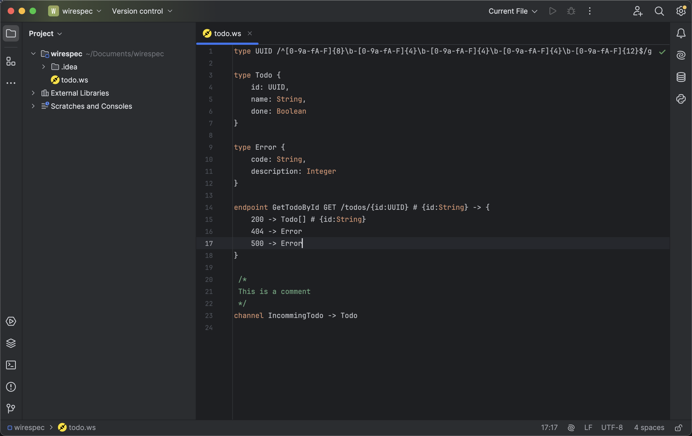
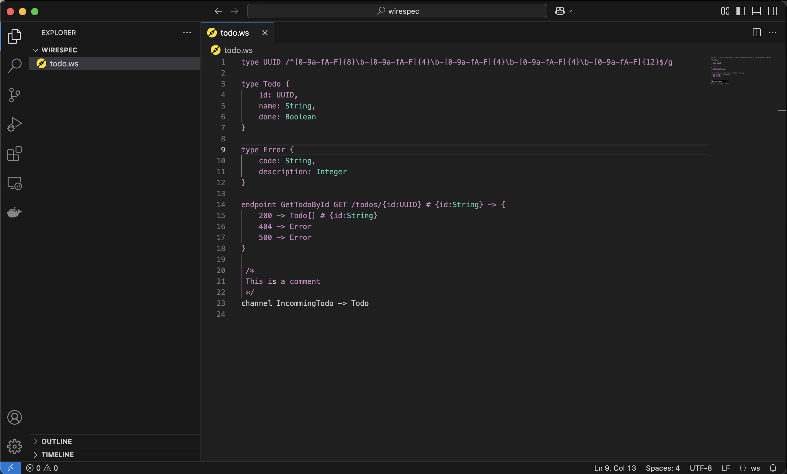

# Integrated Development Environment (IDE)

Wirespec supports two IDEs: IntelliJ IDEA and VS Code.

## IntelliJ IDEA

### Installation

- Install from the JetBrains Marketplace.

### Features

- Syntax highlighting
- Compile error detection
- Refactoring options
- Find usages functionality

## VS Code

### Installation

- Install from the Visual Studio Code Marketplace.

### Features

- Syntax highlighting
- Compile error detection
- Go-to-definition for user-defined types
- Rename Symbol (F2) for user-defined types

## Under the hood

Both IDEs share a single editor-agnostic [Language Server](./lsp.md) that does the parsing, validation, and refactoring. The same server can be driven from any LSP-capable editor or from a coding agent — see the [Language Server page](./lsp.md) for details.

## Syntax highlighting elsewhere

For editors and tools without a language server, Wirespec ships two grammars:

- A [TextMate grammar](https://github.com/flock-community/wirespec/tree/master/src/ide/textmate) (`source.wirespec`), the format of GitHub, VS Code, Sublime Text and Shiki. The VS Code extension uses it to color files before the language server has started.
- A [Prism grammar](https://github.com/flock-community/wirespec/tree/master/src/ide/prism) (`wirespec` and `ws`), which highlights the code blocks on this site.
